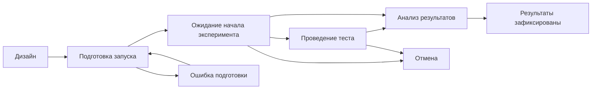
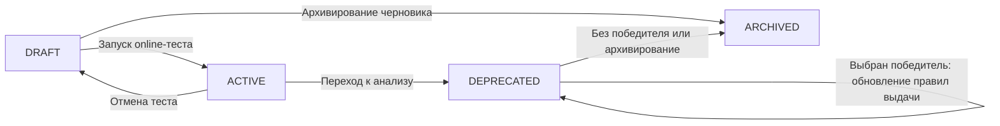

# Жизненные циклы тестов, разметок и тоглов

[Карточка продукта](../README.md) · [Все возможности](capabilities.md) · [Сплитование](splitting.md) · [Сценарии](use-cases.md) · [Технический обзор](technical-overview.md) · [Запросить доступ](../ACCESS.md)

В Calutron состояние эксперимента, состояние набора участников и состояние выдаваемых вариантов продукта управляются раздельно и связаны бизнес-правилами — Rule Policy. Ролевые правила, Role Policy, определяют, кто вправе выполнять действия.

## Три связанных объекта

| Объект | Что описывает его состояние |
|---|---|
| **Тест** | На каком этапе находится эксперимент: подготовка, запуск, проведение, анализ, фиксация результатов или отмена |
| **Разметка** | Что происходит с набором: ожидание, первичное распределение, проверка групп, донабор, ошибка или завершение |
| **A/B-тогл** | Участвует ли параметр в выдаче вариантов продукта и какие правила действуют после завершения эксперимента |

Например, группы уже могут быть наполнены, а тест — продолжаться для наблюдения за результатом. После окончания теста тогл также может продолжать выдавать значение по правилам принятого решения.

## Основной жизненный цикл теста

Схема показывает основные направления. Каждый переход требует выполнения правил для типа теста, состояния разметки и связанных тоглов.

| Этап | Что делает команда и что проверяет платформа |
|---|---|
| Дизайн | Задаются группы, метрики, фильтры, сроки, параметры распределения и роли. Можно оценить аудиторию, изменить или скопировать дизайн |
| Подготовка запуска | Проверяются наличие групп, согласованность размеров, сроки и готовность связанных объектов. Ошибка подготовки выделяется в отдельное состояние с возможностью повторного запуска |
| Ожидание начала | Для online-теста ожидается первое назначение; для offline-теста выполняется первичная разметка и проверка полученных групп |
| Проведение | Ведётся эксперимент и, если предусмотрено дизайном, набор участников или донабор по расписанию |
| Анализ результатов | Новое участие в завершённом эксперименте прекращается; команда изучает показатели и формулирует выводы |
| Результаты зафиксированы | Сохранены ссылка на анализ, комментарий и решение о победителе либо итог без выбора победителя |
| Отмена | Команда прекращает эксперимент отдельным действием; для online-теста прекращается выдача его тоглов |

Для offline-теста переход к проведению связан с подтверждением первичных групп. До подтверждения разметку можно отклонить и вернуть тест к дизайну.

## Жизненный цикл разметки

### Online

Разметка включает назначения по мере обращения пользователей. Завершение набора возможно по сроку, по заполнению групп с абсолютными размерами или при допустимом завершении теста пользователем.

Появление первого участника переводит ожидающий online-тест к проведению. Завершение разметки по размеру фиксирует, что набор закончен; дальнейшее поведение теста зависит от периода наблюдения.

### Offline

Первичное распределение проходит путь «ожидание → разметка → проверка количества участников → подтверждение». Пустая выборка и ошибка выделяются в отдельные состояния, чтобы их можно было отличить от успешного результата.

После подтверждения возможен повторяющийся цикл: «ожидание очередного времени → донабор → завершённый проход → следующее время». Ошибка донабора отражается отдельно и допускает новую попытку по расписанию. При достижении условий заполненности набор завершается.

Подробности проверки групп, повторного запуска и сохранения существующих назначений описаны на странице [о сплитовании](splitting.md).

## Период набора и период наблюдения

Дата завершения набора и дата завершения эксперимента выполняют разные задачи. В дизайне можно учитывать время, которое нужно участникам для наблюдения эффекта после назначения.

Для online-теста при заполнении групп с абсолютными размерами:

- если дополнительный период наблюдения равен нулю, тест может сразу перейти к анализу, а тоглы — в `DEPRECATED`;
- если период задан, разметка завершается, а тест продолжает период наблюдения. Тоглы остаются активными до перехода теста к анализу.

Для относительных групп доли определяют распределение, поэтому достижение фиксированного размера не служит критерием окончания набора.

## Жизненный цикл A/B-тогла

| Состояние | Значение для продукта |
|---|---|
| `DRAFT` | Тогл подготовлен: определены имя, значения и ответственность команды. В выдаче вариантов он ещё не участвует |
| `ACTIVE` | Тогл используется в действующем online-эксперименте. Пользователь получает значение, связанное с его группой |
| `DEPRECATED` | Эксперимент перешёл к анализу. Новые назначения для него не выполняются, а выдача определяется существующими значениями и последующим решением о победителе |
| `ARCHIVED` | Тогл выведен из использования и перестаёт возвращаться как действующий параметр |

`DEPRECATED` означает отдельный режим работы после эксперимента. Он позволяет сохранить значения для уже получавших тогл пользователей, а затем применить решение команды. Сам переход в это состояние не выбирает победителя.

## Как состояния теста меняют поведение тоглов

| Событие | Требование Rule Policy | Что происходит с тоглами |
|---|---|---|
| Запуск online-теста | Выбранные для групп тоглы находятся в `DRAFT`; дизайн и сроки допускают запуск | Связанные тоглы переходят в `ACTIVE` |
| Первое назначение | Тест находится в ожидании и может перейти к проведению | Тоглы продолжают работать в `ACTIVE` |
| Завершение набора при ненулевом периоде наблюдения | Выполнены условия заполненности | Тест продолжает наблюдение; завершение набора само по себе не архивирует тоглы |
| Переход к анализу | Состояния теста и разметки допускают завершение; для online-теста связанные тоглы должны быть активными | `ACTIVE → DEPRECATED` |
| Финализация с победителем | Тест находится на анализе; связанные online-тоглы находятся в `DEPRECATED` | Для значений победившей группы задаются правила дальнейшей выдачи; тоглы остаются в `DEPRECATED` |
| Финализация без победителя | Выполнены условия финализации | Связанные online-тоглы переходят в `ARCHIVED` |
| Отмена online-теста | Состояния теста, разметки и тоглов допускают отмену | Связанные тоглы возвращаются в `DRAFT` и убираются из выдачи |
| Отдельное архивирование тогла | Тогл находится в `DRAFT` или `DEPRECATED` | Тогл переходит в `ARCHIVED` |

Эта автоматическая связь с выдачей тоглов относится к online-сценарию. Для offline-тестов отдельно фиксируются назначенные группы, результаты и победитель.

## Победивший вариант и дальнейшая выдача

Команда может завершить анализ с выбором победившей группы или без победителя.

При выборе победителя для online-теста доступны два поведения:

- **Для уже получавших тогл пользователей.** Их прежнее значение заменяется значением победившей группы при последующих обращениях.
- **Для всех пользователей.** Выбранное значение выдаётся также пользователям, которые ранее не получали тогл этого эксперимента.

Если победитель не выбран, финализация архивирует связанные тоглы. Приложение перестаёт получать их из Calutron; дальнейшее поведение приложения определяется его собственными правилами.

Выбор победителя и распространение значения на всех пользователей — явные решения команды. Наличие статистического сравнения не запускает их автоматически.

## Rule Policy: условия выполнения действий

Правила связывают действия с текущим состоянием объектов. В частности, проверяются:

- допустимость перехода теста из его текущего состояния;
- совместимость действия с типом и состоянием разметки;
- наличие групп и согласованность их размеров;
- сроки эксперимента и наличие времени для набора;
- состояние связанных тоглов на старте, при переходе к анализу и при фиксации результата;
- допустимость изменения дизайна на текущем этапе.

Например, активный тогл нельзя отдельно архивировать по тому же правилу, что черновик. Перед фиксацией результата online-тест проходит этап анализа, а связанные тоглы должны быть переведены в `DEPRECATED`. Подтверждение offline-разметки требует подходящего состояния групп и теста.

Для действующего теста доступен ограниченный набор изменений, включая описания, дату окончания и, для online-сценариев, долю трафика. Пересборка дизайна и изменение состава групп относятся к этапу подготовки. Это помогает сохранять смысл уже выполняемого эксперимента.

## Role Policy: кто может выполнять действия

| Роль | Назначение |
|---|---|
| Наблюдатель | Просмотр доступных экспериментов, групп, метрик и тоглов |
| Редактор команды | Создание объектов и разрешённые действия с тестами и тоглами, к которым у пользователя есть права |
| Администратор | Административные операции и управление объектами с расширенными полномочиями |

Для изменения теста, запуска, оценки аудитории и работы с тоглом учитываются права на конкретный объект. Право выполнить действие проверяется вместе с бизнес-условиями: расширенные полномочия сами по себе не заменяют проверку допустимости перехода.

Авторство, изменения и история состояний помогают восстановить контекст принятых решений. Напоминания поддерживают переход от завершённого эксперимента к анализу и дальнейшему завершению работы с тоглами.

**[Обсудить процесс управления экспериментами →](../ACCESS.md)**
