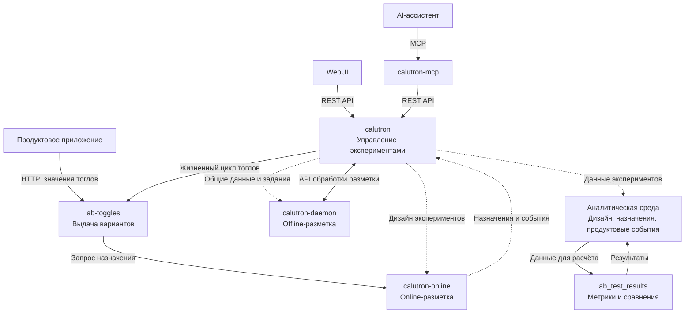

# Технический обзор Calutron

[Карточка продукта](../README.md) · [Возможности](capabilities.md) · [Сценарии](use-cases.md) · [Запросить доступ](../ACCESS.md)

Calutron объединяет управление экспериментами, назначение участников, выдачу вариантов продукта и расчёт результатов. Компоненты разделены по этим задачам: приложение получает значения тоглов, продуктовая команда управляет дизайном через API или WebUI, а аналитические расчёты используют данные экспериментов и событий.

## Общая архитектура

Диаграмма показывает основные взаимодействия. Пунктир обозначает передачу данных через хранилища или события.



Backend хранит дизайн и управляет состояниями. Online-компонент назначает группы при обращении; offline-worker заранее формирует аудиторию и выполняет донабор. Расчёт результатов идёт в аналитической среде. Выводы и победителя команда фиксирует через backend после анализа.

## Основные компоненты

В подготовленный закрытый комплект входят исходники шести компонентов:

| Компонент | Ответственность |
|---|---|
| `calutron` | Дизайн экспериментов, бизнес-правила, права доступа, справочники и жизненные циклы |
| `calutron-online` | Проверка условий участия и назначение клиента в группу online-эксперимента |
| `ab-toggles` | Выдача значений тоглов приложению, кеширование и применение выбранного победителя |
| `calutron-daemon` | Предварительная оценка аудитории, offline-распределение, стратификация и донабор |
| `ab_test_results` | Расчёт метрик участников и групп, статистические сравнения по данным аналитической среды |
| `calutron-mcp` | Доступ AI-ассистентов к выбранным операциям платформы и калькулятора |

WebUI и внешний Calculator API используются платформой; их исходники в этот комплект не входят. Расширенные материалы и доступ к исходникам предоставляются по [запросу](../ACCESS.md).

## Технологический стек

| Технологии | Применение |
|---|---|
| Python, FastAPI, Pydantic, SQLAlchemy | Сервисная логика, API, проверка данных и работа с БД |
| PostgreSQL | Дизайн, состояния, назначения, задания и данные аудита |
| Redis | Данные online-разметки и кеш выдачи тоглов |
| Kafka | Передача online-назначений и событий в backend |
| APScheduler, pandas | Фоновые задачи и обработка offline-выборок |
| PySpark | Расчёт метрик и статистических сравнений |
| FastMCP | Интерфейс для MCP-клиентов и AI-ассистентов |
| Keycloak / OpenID Connect | Пользовательская аутентификация для управления платформой |

## Механизмы интеграции

**API управления.** WebUI и внешние инструменты обращаются к REST API backend для работы с дизайнами, группами, метриками и тоглами. Доступные изменения зависят от прав пользователя и состояния объекта.

**Получение вариантов продукта.** Приложение запрашивает значения тоглов по идентификатору участника. `ab-toggles` использует существующее назначение либо обращается к online-разметке. Приложение интерпретирует полученные значения и выбирает соответствующее поведение.

**MCP.** Ассистент может находить эксперименты и метрики, создавать дизайны, запрашивать предрасчёт и обращаться к калькулятору. Пример параметров вызова инструмента для чтения первых пяти тестов:

```json
{
  "name": "calutron_get_tests",
  "arguments": {"limit": 5}
}
```

Это параметры MCP-вызова; клиент обеспечивает соединение и авторизацию. Действия выполняются от имени пользователя. SQL-инструменты подготавливают запросы для аналитика; выполнение запросов относится к его аналитической среде.

**Аналитические данные.** Расчёт результатов использует копии дизайна, назначений и продуктовые события в хранилище данных. Источники и трактовка событий согласуются с аналитической моделью принимающей команды.

## Доступ, аудит и наблюдаемость

- Управляющее API проверяет аутентификацию, роли и права на изменяемые объекты. Бизнес-правила дополнительно проверяют допустимость действия в текущем состоянии.
- MCP передаёт пользовательскую авторизацию в целевые API. Runtime-выдача тоглов использует отдельную сервисную аутентификацию.
- Аудит разметки помогает разбирать назначения и исключения участников. Для тоглов ведётся история состояний; в объектах сохраняются сведения об авторстве и изменениях.
- Backend и runtime-сервисы используют технические логи и экспорт метрик для наблюдения за запросами и соединениями с Redis. Сбор, хранение логов, дашборды и оповещения подключаются в инфраструктуре принимающей команды.

Эти механизмы описывают возможности компонентов. Конкретные правила доступа, хранения аудита и эксплуатации определяются при согласовании интеграции.

## Инфраструктурные зависимости

Для соответствующих сценариев используются PostgreSQL, Redis, транспорт событий Kafka, провайдер идентификации и аналитическая среда для PySpark. Дополнительные интеграции обеспечивают файловые операции, уведомления и статистический калькулятор.

Закрытый комплект предназначен для изучения и адаптации бизнес-логики. Конфигурация окружений, инфраструктура развёртывания и интеграции с источниками данных готовятся отдельно. Подбор ресурсов зависит от частоты запросов тоглов, числа активных тестов, размера offline-аудитории, объёма событий и требований к доступности. Оценку CPU, памяти и хранилищ обсуждают для согласованного сценария.

**[Обсудить интеграцию или запросить исходники →](../ACCESS.md)**
